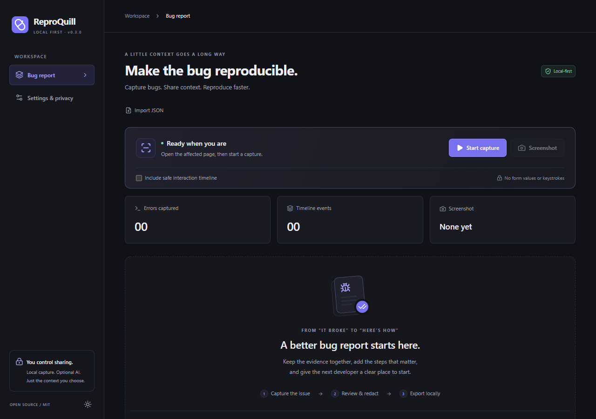
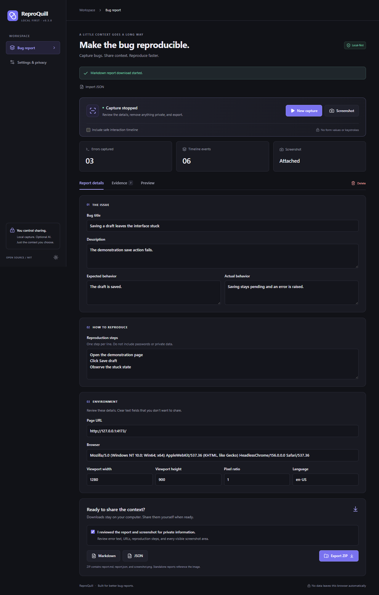
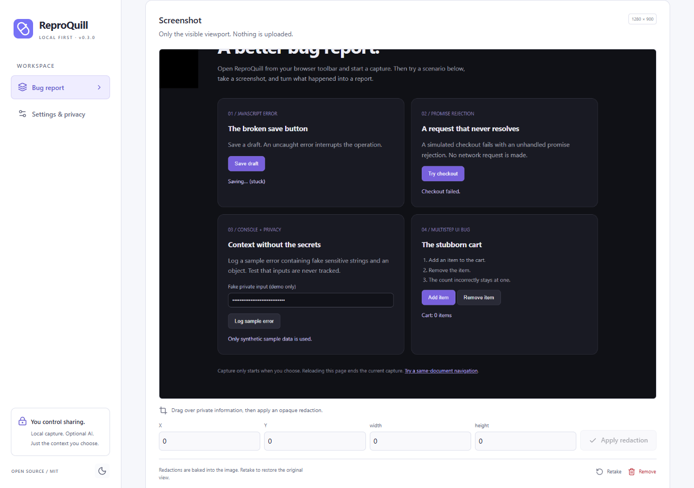
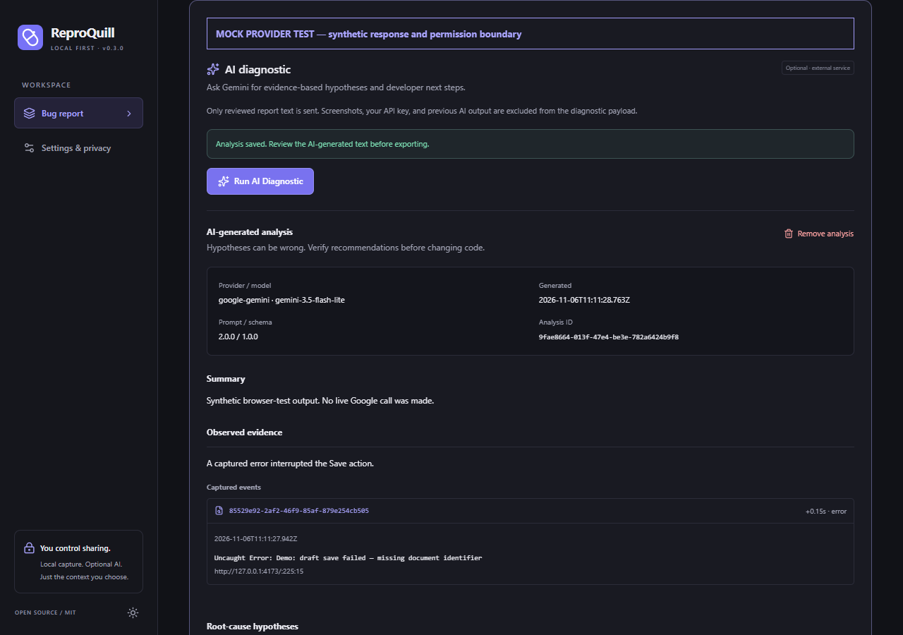

# ReproQuill

**Capture bugs. Share context. Reproduce faster.**

ReproQuill is a local-first Chrome extension for writing reproducible bug reports. Start it on the affected page, trigger the bug, and save a report with the steps, browser context, new errors, and an optional redacted screenshot. An optional Gemini diagnostic can suggest debugging hypotheses after you review and approve the text sent to Google. A developer can read the exported Markdown or JSON without installing the extension.

The project launched as BugCapsule. [GitHub repository](https://github.com/Yamiakumi/reproquill)



## Install the unpacked extension

If you already have a built `dist` directory, skip directly to step 2.

1. Install Node.js 24 LTS and pnpm 11.25.0, then run these commands in this repository.

   ```sh
   pnpm install --frozen-lockfile
   pnpm build
   ```

2. Open `chrome://extensions`, enable **Developer mode**, select **Load unpacked**, and choose **`dist/`**, the directory containing the generated `manifest.json`.
3. Pin **ReproQuill** from Chrome’s Extensions menu. Open a normal HTTP or HTTPS webpage. Clicking the toolbar icon opens the dashboard. Recording begins only when you press **Start capture**.

The manifest targets Chrome 120 or later. Build dependencies require an initial download. The capture, editor, export and local demo work offline. The optional AI diagnostic requires internet access and your own Gemini API key. No `.env` file or ReproQuill backend is required.

## Reproduce a bug in the demo

1. Run `pnpm demo` and open [the local playground](http://127.0.0.1:4173). The demo binds only to the loopback interface.
2. Click the ReproQuill toolbar icon. Optionally select **Include safe interaction timeline**, then **Start capture**. The toolbar badge reads **REC**.
3. Return to the page and click **Save draft**. The interface stays on “Saving…” and raises an uncaught JavaScript error. **Try checkout** produces a rejected promise. **Log sample error** tests redaction with synthetic data. **Add item → Remove item** reproduces a stale cart count without a JavaScript exception.
4. Reopen ReproQuill on the demo tab. Click **Screenshot** to capture its visible viewport, then **Stop capture**. The optional **Open editor** button gives you a full browser tab for editing.
5. Enter a bug title, expected and actual behavior, and one reproduction step per line. In **Evidence**, edit or remove events. To redact the screenshot, drag a rectangle or enter pixel coordinates, then choose **Apply redaction**. Repeat for other areas. **Save changes** commits the new image and report.
6. Inspect **Preview**, then select **I reviewed the report and screenshot for private information**. Download **Markdown**, **JSON**, or **Export ZIP**. A content change clears the review, so review again after editing.
7. Select **Delete** and confirm **Delete all data**. Return to the demo page and start a second capture. Files already downloaded remain on your computer.





## What goes into a report

| Field | Behavior |
| --- | --- |
| Report details | Editable title, description, expected behavior, actual behavior and ordered reproduction steps |
| Environment | Page URL with credentials, query and fragment removed, user agent, viewport dimensions, device pixel ratio and browser language |
| Diagnostics | New `console.error` calls, JavaScript errors and unhandled promise rejections, with UTC and relative timestamps. Location and stack details depend on what the browser exposes |
| Interaction timeline | Off by default. Uses generic descriptions such as “Clicked button” and limited same-document navigation markers |
| Screenshot | One explicitly captured PNG. Retaking replaces the attachment. Manual redaction paints opaque pixels into a new image |
| AI diagnostic | Optional, validated Gemini-generated hypotheses with references to actual captured event IDs, debugging steps, missing evidence and provenance. Review suggestions against source and tests |

| Download | Contents |
| --- | --- |
| Markdown | Human-readable text. An attached image is referenced as `screenshot.png` |
| JSON | New reports use version `1.2.0` with an optional structured `aiDiagnostic`. Legacy `1.0.0` and `1.1.0` reports, including existing string analysis, remain readable. The [JSON Schema](public/report.schema.json) describes supported versions |
| ZIP | `report.md`, `report.json`, and `screenshot.png` when attached. The same saved report produces the same archive bytes |

## Privacy, permissions and limits

| Permission | Purpose |
| --- | --- |
| `activeTab` | Chrome grants temporary access when the user invokes ReproQuill on a tab. The extension uses it to capture that document and take an explicitly requested screenshot |
| `scripting` | Installs and removes observers in the main frame after Start. The main-world hook can observe the page’s own console errors |
| `storage` | Holds one current capture in trusted extension session storage, across popup closes and service-worker restarts |
| Optional Google host access | Requested when you explicitly send an AI diagnostic. Allows requests only to `https://generativelanguage.googleapis.com/` |

ReproQuill requests no website-wide host access. It has no analytics, cookie access or request inspection. The Google endpoint is used only for explicitly approved AI analysis. Report data clears when the browser session ends or the extension reloads. Export anything you want to keep. Theme and model/retry preferences persist. You may explicitly choose to remember your own API key on the device.

- **Capture has a start and end.** Earlier errors, other tabs, iframes, workers, network logs and arbitrary console objects are outside its scope. Reloading, closing or navigating the document ends collection. Same-document `hashchange` and `popstate` events are observable. SPA navigation coverage is partial.
- **Capture is bounded.** A session lasts up to 15 minutes and 200 events. High-frequency events may be dropped. Messages are capped at 2,000 characters and stacks at 4,000. If the screenshot exceeds the 2,000,000-character encoded size limit, reduce the browser window size and retake it.
- **Review remains necessary.** Known secret patterns are masked in text. Paths, free-form messages, and screenshots can still contain private details. Password inputs are excluded from interaction tracking. Visible page pixels, including private page content, may appear in screenshots. An untrusted page can suppress or forge diagnostic messages.
- **Chrome controls access.** Protected pages such as `chrome://` settings and the Chrome Web Store cannot be instrumented. To start or retake a screenshot, use the toolbar popup on the original webpage. If it navigated, start a new capture there.

Read the [threat model](docs/THREAT_MODEL.md) and [security policy](SECURITY.md) for the trust boundaries and vulnerability reporting process.

## Optional AI diagnostic

1. Create a personal API key in [Google AI Studio](https://aistudio.google.com/apikey). Check the project's billing and quota settings before using it.
2. In **Settings & privacy**, enter your key. It is kept for the browser session unless you select the option to remember it on this device. Chrome storage is restricted to trusted extension contexts, but it is not an encrypted secrets vault. Select the model explicitly. The lightweight `gemini-3.5-flash-lite` remains the default, and `gemini-3.8-flash` is an alternative. Remove the key when you no longer want it stored.
3. Stop capture, edit the report and **Save changes**. In **Preview**, select **Run AI Diagnostic**. Review the exact compressed, sanitized text payload and the Google disclosure.
4. Explicitly approve sending the reviewed text and grant the optional Google host permission when Chrome asks. The screenshot, API key, previous AI output and full report attachment are excluded from the diagnostic payload. Text, script paths and user-written steps may still contain private information that automatic redaction cannot recognize.
5. Read the summary, observations and expandable hypotheses. Follow evidence references to the captured events and copy debugging steps when useful. Structured provenance records the model, prompt version, timestamp and evidence IDs. Remove an unwanted analysis, then complete ordinary privacy review again before exporting. Legacy free-form analysis remains editable. Editing underlying bug evidence invalidates prior analysis.

Both configured model identifiers are listed as stable by Google. Free-tier access depends on project eligibility and quotas. A billing-enabled key can incur charges. Google's free-tier terms allow inputs and outputs to improve products. Check current provider terms before sending confidential material. ReproQuill never switches models automatically. [Lightweight model](https://ai.google.dev/gemini-api/docs/models/gemini-3.5-flash-lite), [Flash model](https://ai.google.dev/gemini-api/docs/models/gemini-3.8-flash), [pricing and data use](https://ai.google.dev/gemini-api/docs/pricing).

Automatic retries are disabled by default. You can explicitly enable up to two additional attempts for transient failures in Settings, then approve that attempt limit in the transmission review. Exponential backoff, jitter and the provider's `Retry-After` header operate within a 25-second overall deadline. Authentication errors are not retried. A longer quota wait produces an error and requires a later explicit request. Closing the popup does not own the job. A worker restart safely marks an unfinished operation interrupted and never resends it automatically. You can keep editing and exporting locally throughout.

The pipeline is **Bug capture → Redaction → Evidence selection → Gemini → Schema and reference validation → Diagnostic UI → Export**. A valid response can still propose the wrong cause. Genuine event references establish where a suggestion points, rather than proving that the event caused the defect. See the [AI design](docs/AI_DIAGNOSTICS.md) and [troubleshooting](docs/TROUBLESHOOTING.md).

## Import a saved report

Use **Import JSON** to reopen an exported report, including older versions. Imports are validated and require confirmation before replacing a current stopped report. Export privacy review resets. Portable JSON contains only screenshot metadata, so the image attachment must be reattached through a new capture if needed. Internal report JSON that includes image bytes is subject to PNG header and dimension checks and a 16-million-pixel import limit. ZIP import is outside this release.



This screenshot uses a synthetic test response. Current executed checks are recorded in the verification record. Normal AI tests mock Google's response and Chrome's optional permission approval. A personal API key and native permission approval are needed for a live provider smoke test.

## Reproducible evaluation

The evaluation tooling compares a minimal-error baseline with ReproQuill's evidence-selection pipeline using reproducible synthetic defects. Both conditions use the same model and structured response format. Mock runs validate the experiment machinery. Live model quality requires an explicitly authorized live run followed by documented human review. The known causes are withheld from model input. See the [evaluation methodology](docs/EVALUATION.md) for fixture reproduction, A/B commands, scoring, costs and limitations.

## Development and verification

```sh
pnpm check                         # lint, strict TypeScript, Vitest, production build
pnpm exec playwright install chromium
pnpm test:e2e                      # loads the built MV3 extension and starts the demo
```

The project uses React, TypeScript, Vite, CRXJS, Tailwind CSS, Zod and fflate. Source code separates the UI, service worker, isolated content bridge, page instrumentation, privacy filters and report exporters. There is an [architecture guide](docs/ARCHITECTURE.md), a [record of executed checks](docs/VERIFICATION.md), a [roadmap](docs/ROADMAP.md) and [contribution instructions](CONTRIBUTING.md).

ReproQuill is licensed under [MIT](LICENSE). Bundled third-party components retain their own licenses.

See the verification record for executed checks, the distinction between mocked AI tests and a real provider request, and remaining manual checks. Run `pnpm package` to produce a distributable ZIP. Repository publication instructions are in [publishing](docs/PUBLISHING.md).
